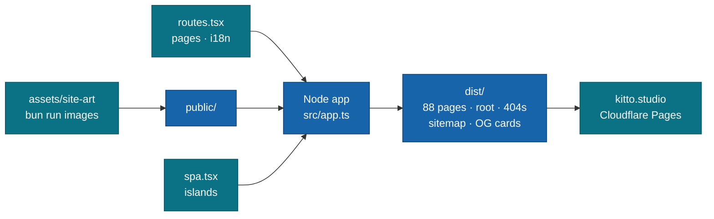

<p align="center">
  
</p>

# Kitto Studio site

**Surely worth playing.**

The website of Kitto Studio, a small family studio that makes puzzle games for phones. It lives at
[kitto.studio](https://kitto.studio): home, about, the games, one page per game, support and the
three legal pages, in 11 languages, light and dark. It is a static site. No server, no accounts, no
analytics, no cookies.

<br/>

[](https://github.com/kitto-studio/site/actions/workflows/ci.yml)
[](https://github.com/moku-labs/web)
[](#deploy)
[](#url-map)
[](#requirements)

<br/>

[What it is](#what-it-is) · [Quick start](#quick-start) · [How it works](#how-it-works) · [URL map](#url-map) · [Store URLs](#store-urls) · [Scripts](#scripts) · [How to](#how-to) · [Deploy](#deploy) · [Docs](#docs)

---

## What it is

- **A store front, not an app.** The App Store and Google Play link here for privacy, support,
  terms and data deletion. Those pages must stay up and stay honest.
- **Every page in every language.** 8 pages × 11 locales = 88 pages, each at its own URL
  (`/en/about/`, `/ja/about/`). The root `/` picks the language.
- **Static HTML first.** Every page is complete without JavaScript. Islands add the motion, the
  menus, the gallery and the merge board.
- **One route table.** `src/routes.tsx` holds every page. Links, the sitemap, the redirects and
  the 404 pages all come from it.
- **Text is text.** Every word comes from `src/i18n` and is drawn by a font. The only lettering
  that is art is the `kitto` wordmark.

## Quick start

```sh
bun install
bun run dev
```

Open <http://localhost:4173/>. The dev server builds, serves, watches and reloads.

> [!NOTE]
> **Status: in build.** All pages exist in 11 languages. Deploys go to Cloudflare Pages only after
> Alex agrees.

## How it works



- `src/app.ts` is the Node side: `@moku-labs/web` defaults plus the build, deploy and cli plugins
  and the site's own `postbuild` plugin.
- `src/spa.tsx` is the browser side: the islands and the in-locale navigation. It carries no page
  code and no string tables (`tests/integration/bundle.test.ts` guards this).
- After the build, `src/plugins/postbuild` writes the per-locale 404 pages, `sitemap.xml` with
  hreflang, `robots.txt`, `_redirects` and the OG cards. See its
  [README](src/plugins/postbuild/README.md).

## URL map

8 pages, each in 11 locales: `en`, `ru`, `uk`, `es`, `pt`, `de`, `fr`, `it`, `ja`, `ko`, `zh`.

| Page | Path | Route name |
|---|---|---|
| Language picker | `/` | `root` |
| Home | `/{lang}/` | `home` |
| About | `/{lang}/about/` | `about` |
| Games | `/{lang}/games/` | `games` |
| A Memory Missing | `/{lang}/games/memory-missing/` | `memoryMissing` |
| Support | `/{lang}/support/` | `support` |
| Privacy Policy | `/{lang}/privacy/` | `privacy` |
| Terms of Use | `/{lang}/terms/` | `terms` |
| Delete your data | `/{lang}/delete-data/` | `deleteData` |

- `/` picks the saved language, then the browser language, then English. Without JavaScript it
  shows the 11 languages as links.
- A bare path such as `/about/` answers 302 with `/en/about/` (`dist/_redirects`).
- Unknown paths get the 404 page of their locale (`/ru/404.html`), or the English one at the root.

## Store URLs

Give the stores the English pages.

| Store field | URL |
|---|---|
| Privacy Policy (App Store, Google Play) | <https://kitto.studio/en/privacy/> |
| Support (App Store) | <https://kitto.studio/en/support/> |
| Terms of Use | <https://kitto.studio/en/terms/> |
| Data deletion (Google Play) | <https://kitto.studio/en/delete-data/> |
| Marketing (App Store) | <https://kitto.studio/> |

Mail: `support@kitto.studio` for support, `delete@kitto.studio` for data deletion
(`src/config.ts`, `EMAILS`).

## Scripts

| Script | What it does |
|---|---|
| `bun run dev` | Build, serve on port 4173, watch and live-reload. |
| `bun run build` | Static build into `dist/`, with the post-build steps. |
| `bun run preview` | Serve the built `dist/`. |
| `bun run images` | Turn the PNG masters in `assets/site-art/` into webp in `public/media/`. |
| `bun run icons` | Render `public/apple-touch-icon.png` and `public/icon-512.png` from `public/favicon.svg`. |
| `bun run lint` | Biome check and oxlint. |
| `bun run lint:fix` | The same, with fixes written. |
| `bun run format` | Biome format. |
| `bun run typecheck` | `tsc --noEmit` (TypeScript 7). |
| `bun run test` | Vitest, unit and integration. |
| `bun run test:coverage` | Unit and integration tests with coverage (what CI runs). |
| `bun run deploy` | Deploy `dist/` to Cloudflare Pages. See [Deploy](#deploy). |

## How to

### Add a gallery picture

1. Put the image in `assets/site-art/game/` and run `bun run images`. It writes the full image and
   a 256 px thumbnail to `public/media/game/`.
2. Add an entry to `GALLERY` in `src/lib/game.ts`: both files, their pixel sizes, `kind` (`art`
   for landscape art, `phone` for a portrait screenshot).
3. Add its alt text and caption keys to `game.gallery` in `src/i18n/types.ts` and in every
   `src/i18n/locales/*.ts`.

### Add a game

1. **Art.** Put the game's art in `assets/site-art/game/` and run `bun run images`.
2. **Route.** Add `/{lang}/games/<slug>/` with `.generate(perLocale)` to `src/routes.tsx`.
3. **Page.** Write `src/pages/<Name>Page.tsx` and attach its layout, body and head in
   `src/pages/index.tsx`. Add the route name to `PageId` and a `meta.<name>` entry.
4. **Strings.** Add the game's strings to `src/i18n/types.ts` and every locale file.
   `tests/unit/i18n.test.ts` fails on a missing key.
5. **Catalog.** Add a card to `src/pages/GamesPage.tsx`. `GameCard` shows A Memory Missing today,
   so give it the game to show.
6. **OG card.** Add a card kind in `src/lib/head.ts` and `src/plugins/postbuild/og/index.ts`.
7. **Legal.** Add the new app ID (`studio.kitto.<game>`) to the privacy and delete-data texts of
   every locale.
8. **Counts.** The sitemap, `_redirects` and 404s follow the route table. Update the page count
   in the postbuild tests (89 URLs today).

### Add a language

1. Add the code to `LOCALES` in `src/i18n/languages.ts`, then its entries in `NATIVE_NAMES`,
   `HTML_LANG` and `OG_LOCALE`. `tsc` lists every record that misses it.
2. Write `src/i18n/locales/<code>.ts` and the three legal files in
   `src/i18n/legal/{privacy,terms,delete-data}/<code>.ts`. Keep every `{slot}` and tag.
3. Wire them in `src/i18n/index.ts` (`STRINGS` and `LEGAL`).
4. Fonts: Latin and Cyrillic are covered. For another script, vendor a font in
   `public/fonts/<family>/`, add `public/css/fonts-<code>.css`, add the code to `CJK`, and add the
   face to `CJK_FACES` in `src/plugins/postbuild/og/index.ts` (from a pinned `@fontsource` package).
5. Typography rules, if the language has them, go in `src/lib/typography.ts`.
6. Run the three review passes and add the language to [docs/translations.md](docs/translations.md).

### Add or change art

1. Put the PNG master in `assets/site-art/<set>/` and add its prompt and size to the
   `manifest.json` beside it.
2. Run `bun run images`. It writes webp (quality 82, at most 1600 px) to `public/media/<set>/`.
   It skips outputs newer than their source, so a rerun writes nothing.
3. Commit the master and the webp together.

The art style and the brief for new pictures are in [brand/STYLE.md](brand/STYLE.md).

## Deploy

- Cloudflare Pages project `kitto-studio`, production branch `main`, domains `kitto.studio` and
  `www.kitto.studio`.
- CI (`.github/workflows/ci.yml`) checks every pull request and deploys every push to `main`. It
  needs the repository secrets `CLOUDFLARE_API_TOKEN` and `CLOUDFLARE_ACCOUNT_ID`.
- By hand: `bun run build`, then `bun run deploy -- --cli`.

Every step, mail routing, the `kitto-studio.com` redirect and rollback:
[docs/runbook.md](docs/runbook.md).

> [!IMPORTANT]
> Deploy only after Alex agrees.

## Requirements

- **Node `>= 24`** and **Bun `>= 1.4.3`**. Use `bun` only, never npm, yarn or pnpm.
- **TypeScript 7**, strict.
- **[`@moku-labs/web`](https://github.com/moku-labs/web)** 2.4.11, the framework.

## Docs

- [brand/BRAND.md](brand/BRAND.md): colours, fonts, logo rules, addresses.
- [brand/STYLE.md](brand/STYLE.md): the full brand system.
- [docs/runbook.md](docs/runbook.md): Cloudflare operations.
- [docs/translations.md](docs/translations.md): languages, review passes, open questions.
- [CLAUDE.md](CLAUDE.md): working rules and the code layout.

## License

Private. © 2026 Kitto Studio. The art, the game art and the wordmark may not be reused.
